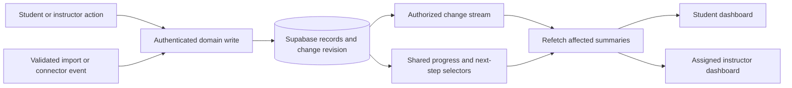

# Dashboard data, persistence, and live updates

Status: proposed implementation plan, September 10, 2026. Planning only; no application, schema, production configuration, or external account changes.

## Outcome and scope

Student input should be saved to the student's account, survive refresh/logout/device changes, and promptly update the appropriate student and instructor views. Imported credentials should enter the same evidence and review workflow. A dashboard summarizes these records and offers a next action; the existing owner pages remain the primary editors.

Planning assumption: this targets both dashboards in the main application and supplies the future data contract for the redesign. The existing prototype remains synthetic and isolated. Its in-memory records are not a persistence implementation, and its illustrative benchmarks are not official program rules. The user's Credly account capabilities remain unknown.

Proposed accountable owner: Britt, as project owner, until another person is designated. This is proposed scope to reconcile with PRODUCT_GUIDE.md and PRODUCT_DECISIONS.md before implementation begins; it does not rewrite either authority.

Companion workstream: [Persistent jobs and responsive discovery](2026-09-10-persistent-jobs-and-discovery.md).

## What the current code establishes

These are local source findings, not a live production audit.

| Area | Existing implementation | Gap to address |
| --- | --- | --- |
| Durable student records | Prisma models include Student, Goal, OrientationProgress, FormSubmission, FormResponse, Certification/CertRequirement, PortfolioItem, ResumeData, Appointment, StudentTask, CareerDiscovery, and Application | Inventory each edit path and its dashboard consumers; extend existing domain records instead of creating a second student database |
| Student dashboard | `src/app/(student)/dashboard/page.tsx` loads database records and renders next steps and ambient panels | Server-rendered summaries do not have a common subscription to subsequent writes |
| Readiness | `src/lib/progression/fetch-readiness-data.ts` and `src/lib/teacher/readiness-snapshot.ts` assemble student readiness; `src/lib/teacher/dashboard.ts` also computes teacher overview readiness | Teacher overview counts certification requirements while the student reader queries completed Certification rows and reconciles progression state. Agree on definitions and shared selectors before accelerating refresh |
| Sage persistence | Messages, goal proposals, discovery, memories, and explicit tools have existing write paths | Saving a message is not the same as successfully extracting a fact. Async completion/failure and human review must remain visible |
| Sage freshness | `src/lib/chat-context-write-through.ts` invalidates cached context on watched Prisma writes | This is process-local cache invalidation, not dashboard synchronization. It documents transaction/read races; reuse its dependency knowledge, not its best-effort timing as a durable event source |
| Notifications | `src/lib/notifications.ts`, `/api/notifications/stream`, and NotificationProvider implement SSE | Live delivery uses an in-memory connection map. The stream has a query-string replay option, but the provider does not supply it. This is not a general, durable, multi-instance data-update system |
| Credly | `/api/settings/credly` stores a username; `/api/credly/badges` fetches a public profile and caches badge JSON on Student | Nonempty database cache lasts 24 hours; no scheduled credential reconciliation or progress mapping appears in this path. It reads one response without pagination and conflates empty results with failure |
| Credly account changes | Settings POST/DELETE changes only the username | Cache is not tied to an immutable external account identity or cleared on account replacement; an old badge cache can be presented under a new username |
| Learning links | LmsLink stores links, descriptions, and categories | A link to a learning platform is not completion telemetry |
| Prototype | `prototypes/visionquest-redesign/README.md` and SESSION-CHECKPOINT.md explicitly describe browser-memory state | Preserve this boundary until a separate production implementation is built and verified |

The September 1 audit recorded failed scheduled work; the repository handoff records subsequent repair work and unresolved production steps. Those are historical findings, not confirmation of today's scheduler health. Verify actual executions before relying on scheduled sync.

## Data sources and useful dashboard changes

| Source | How to capture and retain it | Dashboard effect and truth boundary |
| --- | --- | --- |
| Student profile, career direction, preferences | Validated forms writing existing student/profile records, with version checks | Update the personal goal, relevant options, and job search preferences |
| Student conversations with Sage | Persist the message; persist extracted proposals separately with source and processing status | Show a captured/proposed goal or requested action. Preserve current instructor confirmation rules; a sentence in chat does not prove completion |
| Tasks and goals | Explicit student changes and instructor review through existing owner routes | Refresh next action, progress, and the relevant instructor queue |
| Orientation forms and signatures | Versioned FormResponse/FormSubmission records, mapped values and private file references | Distinguish draft, signed, awaiting review, and approved. Preserve the prototype's field IDs, template relationships, and separate signatures when implementing the real workflow |
| Uploaded work and portfolios | Private stored file plus a typed record linked to the requirement/goal it supports | Immediately show submitted evidence; update verified progress only after the required review |
| Instructor corrections and sign-off | Record actor, decision, timestamp, and the version reviewed | Update student status, queue membership, and verified counts together |
| Credly credentials | Badge link/manual review first, supported connector where available, stable badge IDs | Add a credential, update a mapped requirement or review queue, refresh portfolio and relevant job matching |
| Attendance and class participation | Instructor roster entry or reviewed import from the actual attendance system | Update attendance and support needs. App visits or chat messages do not establish class hours |
| Course/exam platforms | Reviewable CSV imports initially; supported API/webhook adapters only after the program's platforms and entitlements are known | Update course milestones or evidence. GMetrix/Certiport or an LMS are candidates to investigate, not integrations this plan claims are available |
| Appointments and support requests | Existing booking/task/advising records; staff-recorded attendance/outcome | Show upcoming meetings and follow-up actions; a passed appointment time does not prove attendance |
| Job interest and applications | Durable per-student preference and application records from the companion plan | Show saved jobs, application follow-ups, interviews, and student-reported outcomes separately from verified placements |
| Uploaded program content and requirement changes | Curated, versioned curriculum configuration; reviewed import mappings | Update guidance and applicable requirements. Uploading a document does not mark student work complete or silently replace an enrolled student's requirement version |
| Time passing | Recompute due/overdue and expiration states on read and on a bounded timer, with scheduled reconciliation where needed | Update overdue tasks and expiring credentials even if nobody edits a record |

Prioritize native student/staff input, evidence review, and Credly. Add another external adapter only when it removes a named manual task. Shared-drive watchers, calendar connectors, or broad automation platforms are not prerequisites.

## Record and verification contract

1. Keep Supabase Postgres as the durable store, accessed through the existing authenticated Next.js APIs and Prisma. File bytes belong in private Storage; structured values, file references, and review state belong in Postgres.
2. Define typed domain fields and validation for each input. Do not make a catch-all JSON dashboard document the source of truth. Extend FormResponse where configurable forms need typed, versioned values.
3. Reuse existing provenance fields and add missing ones only where needed: source, source record ID, actor, occurredAt, recordedAt, record version, verification status, reviewer, and reviewed version. Source timestamps and import timestamps are different facts.
4. Keep workflow status separate from evidence status. A task may be complete while its supporting certification is still self-reported. Preserve unknown provenance for legacy rows; do not bulk-label them verified.
5. Preserve the existing distinction between proposed goals, planning momentum, and instructor-confirmed goals. Do not introduce a new hard gate on all momentum.
6. Every write returns its saved representation and version. Forms show Saving, Saved, or Could not save. Server autosave of drafts is appropriate; device memory is not the durable record. Avoid persistent student data in browser storage as the default on shared devices.
7. Reject or explicitly reconcile stale edits. A teacher cannot approve an old version after the student has changed the evidence. Use idempotency keys for retried creates, imports, and connector events.
8. Use deterministic selectors for counts, eligibility, and next steps. AI may explain or propose; saving and updating the dashboard must continue when AI is unavailable. Stale generated Sage panels should be labeled/rebuilt separately from live factual cards.
9. Define a single metric contract used by student, instructor, and reporting readers: numerator, denominator, included states, applicable requirement version, source, and as-of time. Keep reported progress, pending review, verified requirements, and certificate issuance distinct. XP is not verified readiness.

## Live-update design

Recommended first delivery: retain the app's cookie authentication and use an authenticated SSE channel backed by durable database revisions/change records. This fits the existing browser and server architecture without assuming Supabase Auth is already in use.

- Record the domain mutation and its change revision in one database transaction. Prefer a small, explicit domain mutation helper for initial workflows. If a critical model has too many independent writers, use an audited database trigger for its minimal revision event. Do not publish from a Prisma callback before the transaction commits.
- Add a small StudentDataRevision and committed change/outbox mechanism with student scope, changed domain, version, and event ID. Reuse BackgroundJob for external ingestion work where appropriate; ProgressionEvent remains the progression/reward ledger and Notification remains user-facing messages.
- Emit invalidations, not private record payloads. An authorized client learns which summary changed and refetches it through the existing API. Ordinary saves should not create notification-bell clutter.
- For the initial SSE transport, use a bounded, indexed revision reader independent of the cron worker. Batch authorized scopes and avoid a database query per widget. Same-process delivery can accelerate updates; durable revision reconciliation covers other processes and reconnects. Prove query/connection costs under classroom concurrency before selecting the polling interval.
- Mount one data-update provider per app shell, supporting both roles. Keep notification and data event types explicit. Do not add one connection per card.
- Mutation responses update the initiating UI immediately after save. The stream refreshes other views. Coalesce bursts, compare versions, ignore older responses, and preserve unsaved edits, focus, scroll, selected jobs, and the active chat.
- Use proper event IDs and Last-Event-ID support or an equivalent durable cursor. Subscribe/refetch with a revision handshake so initial loading cannot miss a write. Reconnect and foregrounding always reconcile the latest snapshot; if a replay cursor is too old, issue a reset/refetch.
- Recheck session validity and managed-student scope during delivery, including logout, role changes, class reassignment, and account deactivation. Resolve long-lived reads within the correct RLS context. Cross-class or student-to-student delivery must fail closed.
- Add a visible freshness indicator and a 30-second active-page fallback refresh as a proposed degraded-mode target. Slow or failed reads keep the last good snapshot labeled stale; they do not become zero progress.
- Read-only refreshes must never award XP, mark attendance, mutate goals, or generate new evidence.

Proposed acceptance target: the initiating action shows Saved only after commit; an already-open authorized second view reflects the write within 5 seconds at the 95th percentile under the agreed pilot load. This is a target to test, not a claim about current performance.

### Supabase Realtime alternative

Supabase recommends Broadcast for database-change subscriptions. Private channels need their own authorization policies. Its current authorization checks use JWT/channel membership, whereas VisionQuest's database access uses app-specific session context. Direct browser Realtime therefore needs an explicit token and authorization bridge; an existing httpOnly VisionQuest cookie does not supply this automatically. See [database subscriptions](https://supabase.com/docs/guides/realtime/subscribing-to-database-changes) and [Realtime authorization](https://supabase.com/docs/guides/realtime/authorization).

Choose private Broadcast in a bounded transport spike if it meets the same access-revocation tests with less operational cost than SSE revision polling. Keep the committed revision and refetch contract either way. Do not expose student tables or service credentials to make subscriptions work. If implementing Broadcast, keep application objects in the application schema: the current [Realtime schema restriction](https://supabase.com/changelog/realtime-schema-locked-down-against-modification) still allows policies on realtime.messages but blocks arbitrary schema modifications.

## Credly integration

Current official documentation describes organization OAuth using client_credentials, with scopes including issued_badges, events, and workforce. This does not establish a general student-authorized OAuth connection. Select the least privileges the required endpoints actually support. See [Credly authentication](https://docs.credly.com/browse/docs/authentication-methods).

Credly's [webhook documentation](https://docs.credly.com/browse/reference/post_webhook-callback-url) describes organization-configured HTTPS callbacks, configurable headers, event summaries, and fetching the event details by ID. Relevant listed events include badge.created, badge.state.changed, badge.deleted, privacy changes, and user/employment badge changes. Which events and students the program can access must be verified with its actual entitlement. An issuer account alone does not establish access to every credential from other issuers.

The [employee data endpoint](https://docs.credly.com/browse/reference/get_v1-organizations-organization-id-employees-employee-id-data) can return employer-issued and other public accepted badges. Workforce applicability and connection requirements for this student program need confirmation; do not misrepresent students as employees to obtain access.

Implement in stages:

1. **Make the manual baseline reliable.** Keep one credential connection surface in the existing Learning/Portfolio workflow. Accept badge/profile references, show source and last-check time, and route identity/requirement review to instructors. Clear or segregate caches on account changes. A pasted public username does not prove ownership.
2. **Persist typed credentials.** Proposed CredentialConnection, ExternalCredential, CredentialRequirementMapping, and IntegrationSyncRun records hold stable external identity, badge/template/issuer IDs, badge URL, issued/expiry dates, provider state, first/last seen, last successful sync, and identity/review provenance. Retain immutable references to reviewed evidence. Map by issuer/template identity, not badge-name similarity.
3. **Add the entitled connector.** Store credentials server-side. Accept only configured organizations and authenticated webhook requests using the provider-supported mechanism; current docs support custom headers, so do not invent an HMAC signature header. Store a deduplicated event receipt before acknowledging it, then fetch event details from the authenticated API and process asynchronously. A callback payload alone cannot verify a student's credential.
4. **Reconcile.** Follow pagination; retry safely with backoff and provider limits; maintain cursors and run status. Handle duplicates, out-of-order events, replacements, expiration, revocation, privacy changes, and account disconnects. A failed or partial fetch is not evidence of revocation. Missing public visibility is not the same as an invalid credential.
5. **Apply learning rules.** A new badge appears as imported evidence and creates a review action when needed. Only verified identity plus an owner-approved mapping can satisfy a specific requirement. Final Ready-to-Work sign-off remains the authorized program workflow. Repeated imports cannot award duplicate progress or rewards; a revoked credential preserves history and triggers eligibility review.
6. **Show health.** Connected, Checking, Up to date, Needs attention, and Disconnected include last-success time and a useful next action. Scheduled sync requires observed worker health. Webhook arrival can be prompt; scheduled/public-profile checks are delayed by their configured interval and provider availability.

If the program has only individual public profiles, treat the current public endpoint as a limited compatibility path until its supported use and behavior are confirmed. Offer explicit refresh and reviewed evidence; do not promise instant imports or private badges. Dashboard propagation can still be immediate after VisionQuest commits an import.

## Implementation order and acceptance

| Phase | Deliverable | Acceptance evidence |
| --- | --- | --- |
| 0 — Define truth | Map dashboard fields to writers, canonical records, applicability, verification states, and shared selectors; confirm target dashboards and Credly entitlement | One synthetic student's source records explain every displayed count; student/staff figures agree under their labeled definitions |
| 1 — Save reliably | First vertical slice: student evidence submission → persisted version → instructor review → shared progress/next action | Survives browser reload, logout, server restart, and a second device; failed saves and concurrent edits are explicit |
| 2 — Update open views | Commit revisions, authorized SSE provider, refetch/replay, stale state, fallback, and cache invalidation; complete the transport spike | Two-browser tests satisfy timing target; no data leaks on role/scope change; dropped/duplicate/out-of-order events converge correctly; no update on rollback |
| 3 — Import credentials | Connection cleanup, typed credential records, review mappings, manual import, then entitled webhook/scheduled adapter | Duplicate badge is one record; wrong owner does not gain credit; removal/expiry/outage cases preserve truthful history; scheduler and connector are exercised in a test environment |
| 4 — Broaden inputs | Tasks, goals, forms, attendance, appointments, jobs, approved imports, and time-driven changes use the same contract | Each writer has a mapped consumer; class requirement changes update the right cohort/version; no new dashboard-specific editor |
| 5 — Pilot | One class, explicit observation window, owner feedback, sync health and latency measurement | Students recover saved work, staff can act on current queues, counts agree, and support burden does not increase |

Use synthetic fixtures and a verified nonproduction database for implementation validation. Dependency-backed tests must include RLS as the restricted application role, not just an administrator connection. Validate migrations and backfills before applying them. Roll out additively with feature flags; retain saved records if the stream or connector is disabled. Turning off live transport should leave ordinary save/reload working.

Stop expanding automation if it causes unexplained verified progress, wrong-student linkage, lost edits, or hidden stale data. Correct the source workflow before enabling more integrations.

## Open decisions and handoff

- Does the first release connect the current main-app dashboards or a separately approved implementation of the redesigned journey? This plan shares the same backend contract with either.
- Which Credly organization/issuer or Workforce capabilities are actually available, and which credential templates count toward which requirements?
- Which system owns attendance and course/exam results? Prefer one authoritative source per fact.
- Confirm the official readiness/requirement definitions, data retention rules, and any automatic credential-to-requirement mapping before enabling those decisions. Do not invent retention periods here.

No live database, student record, credential secret, or provider account was accessed for this plan. Sources were repository code/docs and public official provider documentation. No runtime tests were run because this deliverable changes planning documents only.
